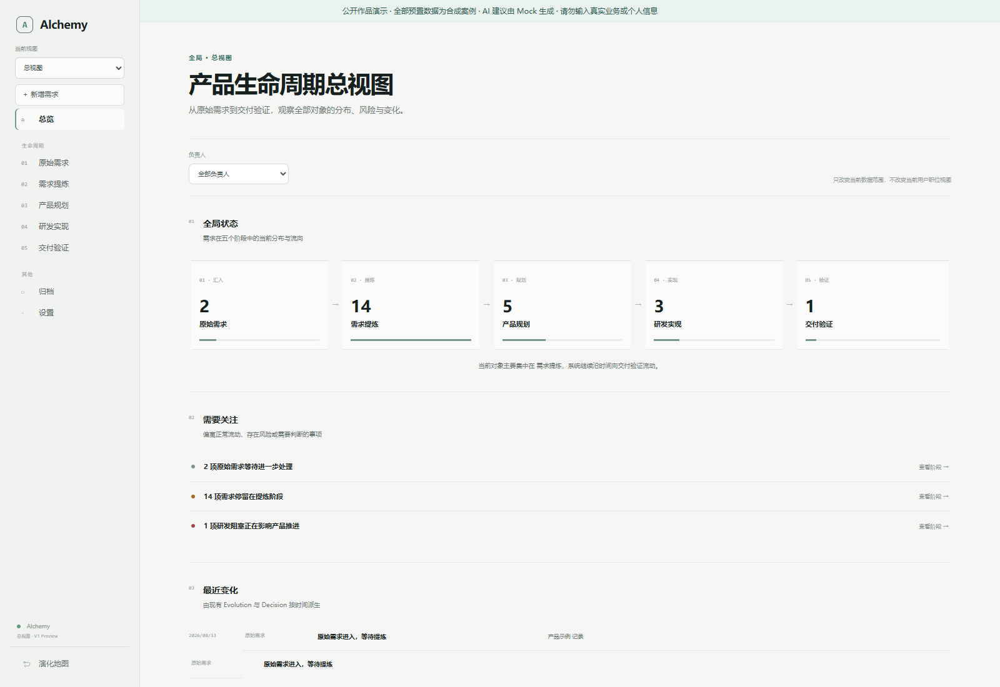
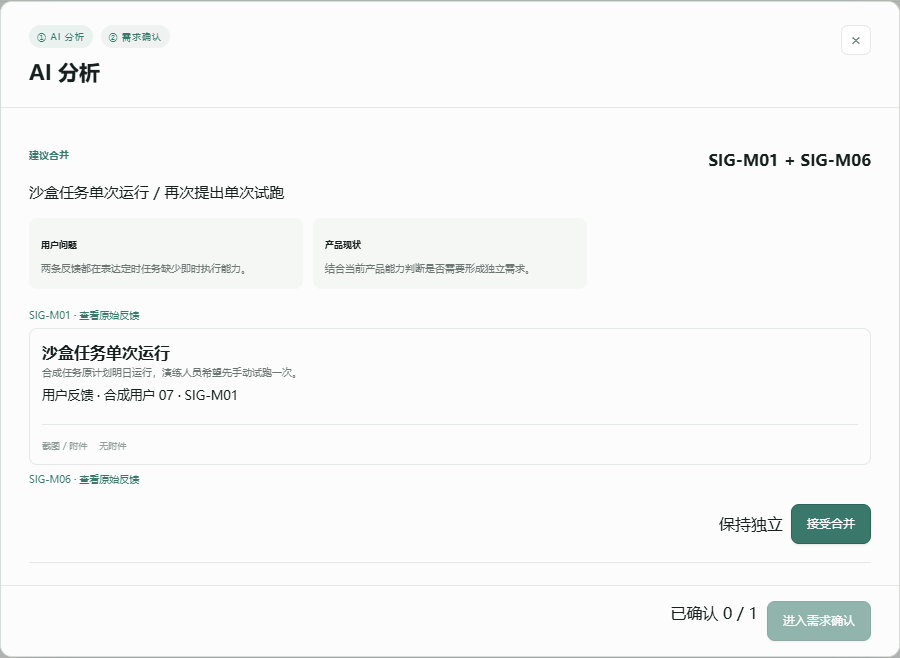
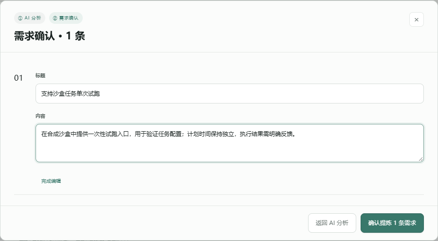
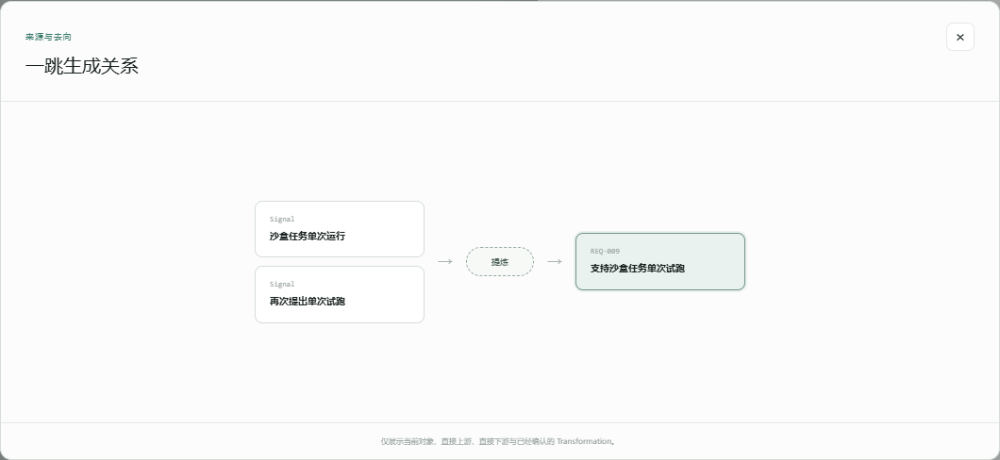
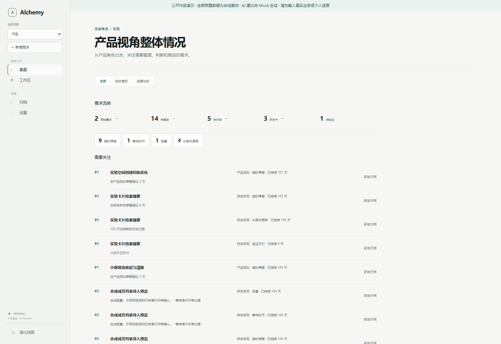
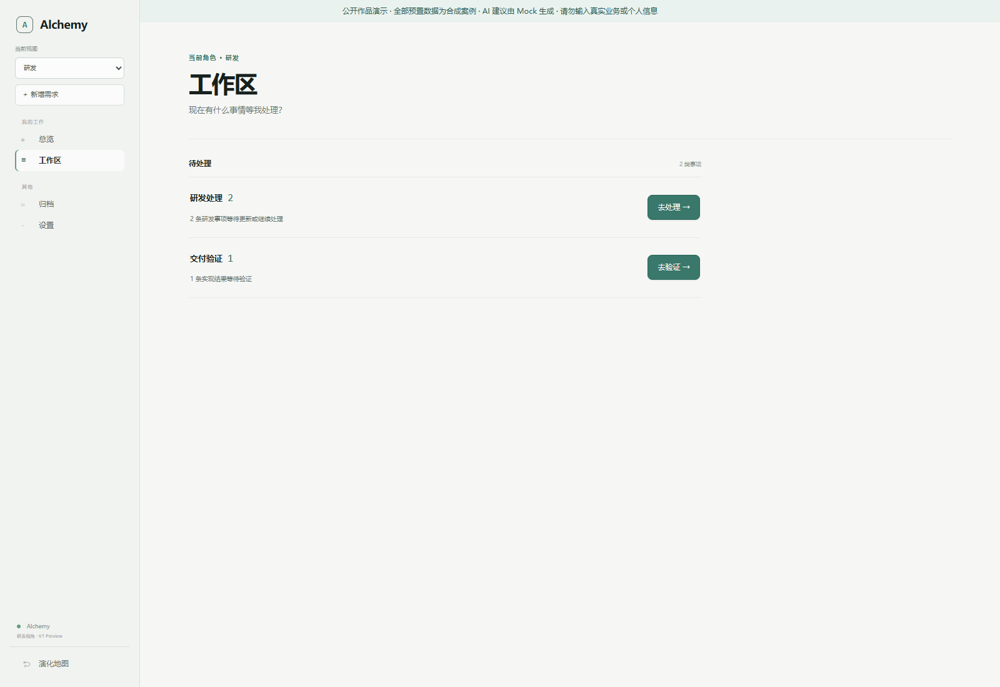
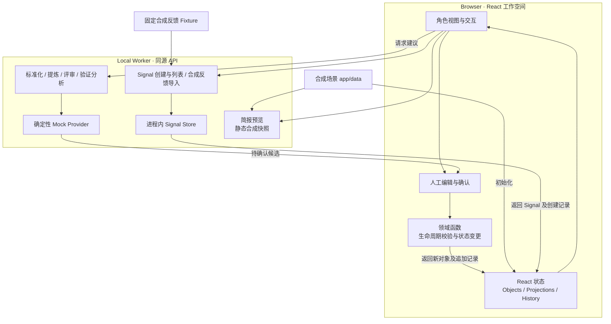
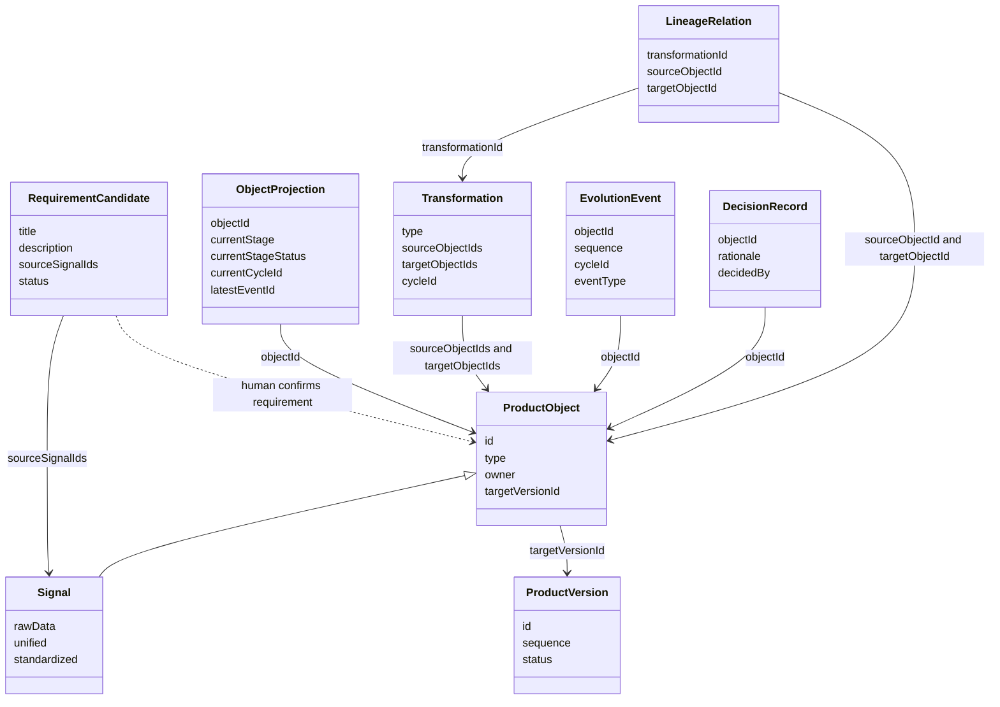

# Alchemy — AI-Native Requirement Workspace

**AI 原生需求演化工作空间：让反馈、候选、人工决策与交付验证保持可追溯。**

A requirement workspace prototype connecting feedback, AI-style drafts, human decisions, and delivery validation through traceable object relationships.

- **生命周期**：原始需求 → 需求提炼 → 产品规划 → 研发实现 → 交付验证。
- **人机决策边界**：Mock 生成候选，人编辑、选择和确认后才形成正式需求。
- **来源追溯**：保留原始反馈、生成关系、演化事件及决策依据。
- **角色视图**：产品、研发、管理从不同位置观察同一批对象。



> 公开求职作品原型 · 合成数据 · Mock-only demo。无真实模型调用、企业连接或外部发送。截图中的进度、用户和业务状态均为虚构；角色切换不代表权限隔离。

[中英文项目简介](docs/PROJECT_BRIEF.md) · [完整截图与三分钟讲解](docs/SHOWCASE.md) · [验证报告](docs/PUBLICATION_CHECK.md) · [本人待确认事项](docs/PROVENANCE.md)

## 产品界面 / Product walkthrough

**Mock 提炼与人工确认。** 两条反馈保留各自来源，Mock 提供合并建议；候选可编辑，确认后才生成 Requirement。以下是实际界面截图，分析内容由固定示例规则生成。





**来源追溯。** 正式需求保留两条来源 Signal 与已经确认的提炼关系；演化页另有操作及决策记录。



**角色视图。** 产品聚焦待判断事项，研发聚焦可处理工作，管理聚焦版本风险。这些是同一对象集合的视图投影。

| 产品总览 | 研发工作区 |
| --- | --- |
|  |  |

[查看管理视图、人工最终确认与完整演化记录](docs/SHOWCASE.md)。

## 已验证结果 / Verified results

2026-11-23，Windows PowerShell，Node.js 24.14.0 / npm 11.9.0。最终准备阶段已重新执行构建、类型检查和既有测试，结果如下；测试数量和产品功能没有增加。

| 验证 | 已记录结果 |
| --- | --- |
| 构建（`npm test` 内执行 `npm run build`） | 成功；框架构建提示详见报告 |
| 类型检查 `npm run typecheck` | 通过，0 类型错误 |
| 领域、安全边界与构建后 API 测试 | **32 通过、0 失败、0 跳过** |
| 本轮既有浏览器流程检查 | 4 组检查点通过，0 页面异常、0 外部请求 |
| 本轮展示截图流程 | 9 张实际截图，0 页面异常、0 外部请求 |
| 上轮依赖审计 | 0 已知漏洞，仅代表该次 registry 审计结果 |

32 项测试覆盖来源保留、候选确认、合并拆分、版本与 Cycle 边界、角色投影，以及公开版不执行外部请求等规则。它们不证明生产可靠性或模型效果。[查看范围、限制与证据](docs/PUBLICATION_CHECK.md)；最新复验见 [最终发布准备](docs/FINAL_RELEASE_PREP.md)。

## 产品设计决策

| 决策 | 解决的问题 | 实现证据 |
| --- | --- | --- |
| Raw / Unified 分层 | 统一管理字段时保留原始事实 | app/domain/signals.ts、app/domain/model.ts |
| 候选与正式对象分离 | 建议可编辑，结构变化需要人工确认 | app/domain/refinement.ts、app/domain/reviews.ts |
| 有向来源关系 | 合并、拆分后仍能追查来源 | Lineage、Transformation 与相关测试 |
| 追加式演化与决策 | 同时解释发生了什么与为什么发生 | Evolution、Decision；当前仅内存记录 |
| 角色投影与对象状态分离 | 切换观察位置不改写业务事实 | app/ui/team-projection.ts、app/domain/attention.ts |
| Cycle 与 Version 解耦 | 区分对象的新一轮处理与发布目标 | app/domain/delivery.ts、app/domain/versions.ts |

## AI 与人工的决策边界

Mock Provider 输出待确认结构和草稿，不直接决定正式 Requirement。人可以改写、拒绝或确认候选，再由领域函数校验并生成对象、来源关系和演化事件。评审备注中的优先级等可被规则提取；合并、拆分、新对象等结构变化仍经过候选确认。

Provider 接口与领域层分离，但公开版只包含 Mock 实现，任何环境变量都不会启用真实模型。这里展示的是 AI Native 产品的治理边界和交互结构，不宣称模型效果、Agent 自主执行或已落地的 AI 基础设施能力。

## 系统架构 / System architecture

浏览器保存工作区对象与演化状态；同源 API 提供 Mock 分析和进程内 Signal 存储。人工确认后的领域变更在浏览器应用，不会被持久化到业务数据库。



边界：无真实模型请求、企业连接或外部消息发送；无业务数据库、登录或租户隔离。Mock 接口与领域规则分离不等于已实现 Agent 执行平台。

技术栈：TypeScript、React 19、Tailwind CSS 4、Vite 8、Vinext App Router / Route Handlers、Cloudflare Workers；Node 测试与 Miniflare 验证构建后 API，Playwright 验证浏览器流程。

## 核心领域模型 / Core domain model



- Requirement 以 `ProductObject.type = "requirement"` 表达，不是独立数据库表；Signal 进一步保留 Raw / Unified 来源字段。
- Candidate 是草稿；人工确认才生成或修改正式对象。确认不覆盖原始 Signal。
- Transformation 记录业务形态变化，Lineage 记录有向来源关系，Evolution 与 Decision 记录发生了什么和为什么发生。
- Cycle 在当前实现中通过 `cycleId` / `currentCycleId` 标识处理轮次，没有独立 Cycle 实体表；Version 是发布目标，与 Cycle 解耦。
- ObjectProjection 保存当前阶段、状态和轮次，领域函数同步更新投影与历史。当前原型没有从持久化事件日志重建全部状态的 event-sourcing 基础设施。

对应源码：[model.ts](app/domain/model.ts)、[refinement.ts](app/domain/refinement.ts)、[reviews.ts](app/domain/reviews.ts)、[delivery.ts](app/domain/delivery.ts)、[team-projection.ts](app/ui/team-projection.ts)。图中箭头表示类型引用或确认关系，不代表新增的服务、数据库或 Agent。

## 快速运行

需要 Node.js 22.13+（本次验证环境见 [公开前检查报告](docs/PUBLICATION_CHECK.md)）与 npm。

```sh
npm ci
npm run dev
```

打开终端输出的本地地址，默认绑定 127.0.0.1。脚本不使用特定 Shell 的环境变量赋值语法，无需密钥；本次实际验证平台为 Windows PowerShell。

```sh
npm run build
npm run test:built
# 或一次完成构建与测试
npm test
```

## 演示路径

1. 在总视图查看五阶段分布，切换产品、研发、管理视角，观察同一对象的注意事项与可处理工作队列。
2. 进入原始需求，选择手动新增，录入一条虚构反馈；保留原话，再执行标准化与人工确认。
3. 在需求提炼中选中 SIG-M01 与 SIG-M06，查看合成“单次试跑”分组建议；修改草稿后确认生成 Requirement。
4. 查看对象的“来源与去向”和演化记录，再进行评审、版本规划、实现状态更新与交付验证。
5. 用预置需求演示合并、拆分及验证后进入下一轮；来源对象继续保留。
6. 新需求菜单可导入固定合成反馈；重复导入按来源 ID 去重。设置页仅预览预置快照简报。

UI 中的“AI”描述工作流中的候选生成角色；此版本实际由 Mock 执行，不代表实时模型推理。Mock 对部分固定案例预设合并与拆分，数值 confidence 也是演示值，不是评测指标。

## 实现状态与限制

| 能力 | 当前状态 |
| --- | --- |
| 五阶段视图、需求输入、提炼、评审、版本规划、实现与验证 | 原型已实现，使用内存状态 |
| 来源关系、演化记录、角色投影 | 已实现；不是权限或不可篡改审计系统 |
| 分析与标准化 | 确定性 Mock，部分案例使用固定规则 |
| 反馈导入 | 只导入固定合成 Fixture，不接受外部地址或凭证 |
| 简报 | 只预览预置快照，不反映浏览器本轮修改 |
| 表格导入、归档 | 未实现，仅保留边界说明或入口 |
| 持久化、登录、RBAC、租户隔离、定时调度 | 未实现 |
| 真实模型、企业连接、消息发送 | 从公开版移除或显式拒绝 |
| Skill / Agent 运行与通用工作流引擎 | 未实现；属于探索方向 |

刷新会丢失浏览器中的需求演化变更；重启会清空服务端新增 Signal。不同会话可能共享服务端内存，禁止输入真实业务、个人信息或秘密。本版本用于本地作品演示，尚未经过公共多用户服务的安全加固。

## 本地验证命令

```sh
npm run typecheck
npm run check:public
npm audit
```

浏览器验证：先运行 `npm run dev -- --port 4173`，再在另一终端运行 `npm run test:browser`。Windows 使用已安装的 Edge 无头实例；其他平台需先通过 Playwright 安装 Chromium。仅本次 Windows 环境已实际验证。截图和本地日志写入被忽略的 artifacts/。

## 验证与发布边界

实际命令结果、敏感信息复扫、原始源码未改动核验及待确认项记录在 [公开前检查报告](docs/PUBLICATION_CHECK.md)。测试证明具体规则，不证明生产可靠性或模型效果。

此快照不携带旧 Git 历史，尚未发布。创作事实已由作者确认；原创部分已确定仅供求职作品展示、不授予开源许可；旧图标和未知模板包装已替换或移除，职务成果公开权利仍待确认。详见 [来源与授权状态](docs/PROVENANCE.md)、[第三方许可核查](docs/THIRD_PARTY_AUDIT.md) 和 [NOTICE](NOTICE)。原创部分的权利说明见 [COPYRIGHT.md](COPYRIGHT.md)；第三方仍适用各自原许可。

作者已确认：产品构思、需求分析、系统设计、领域建模与开发过程由本人主导；全部代码通过 Codex 辅助生成和迭代，无其他人工贡献者。原 Git 作者身份均为本人。该陈述不覆盖第三方组件，也不代替职务成果权属确认。没有宣称真实用户规模、商业成果或效率提升。
