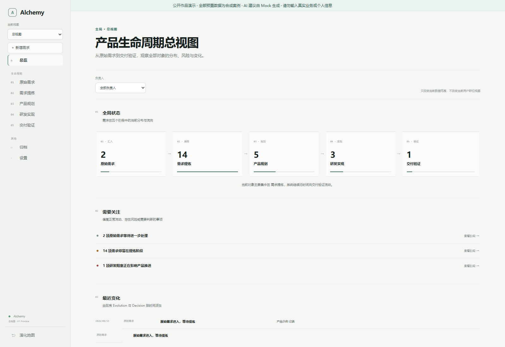
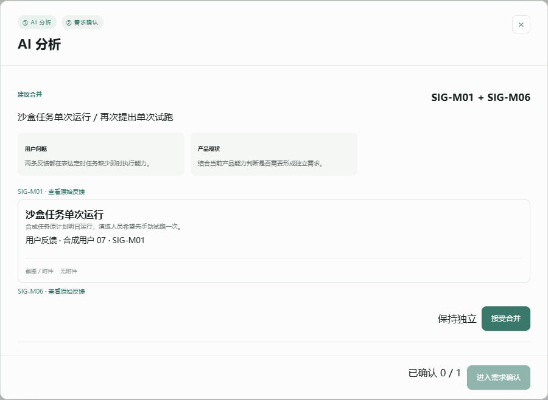
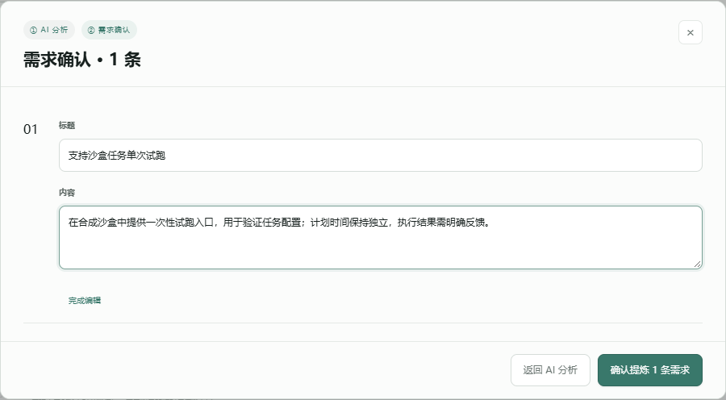
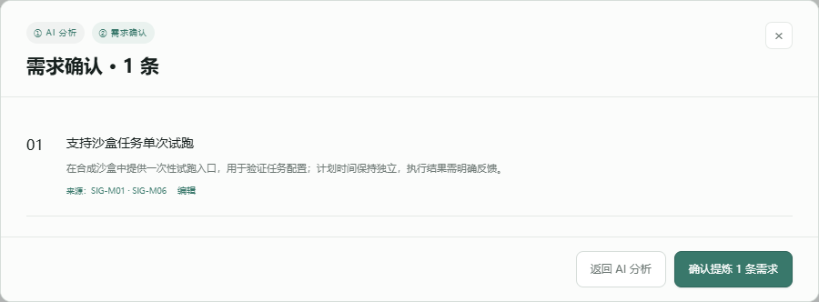
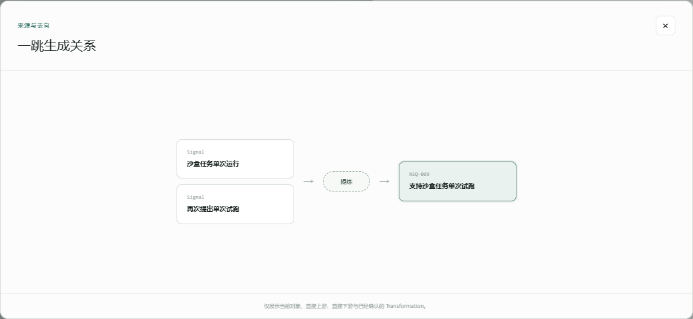
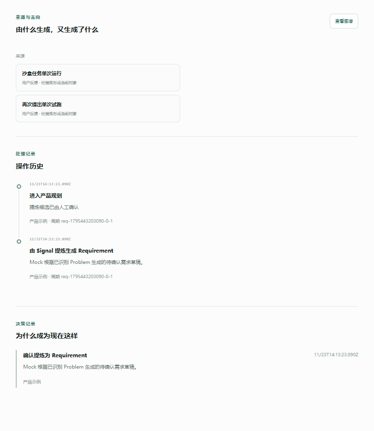
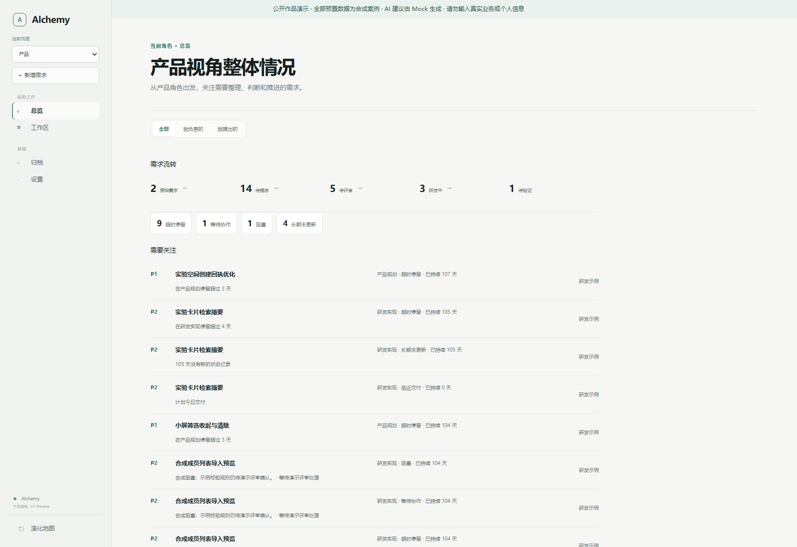
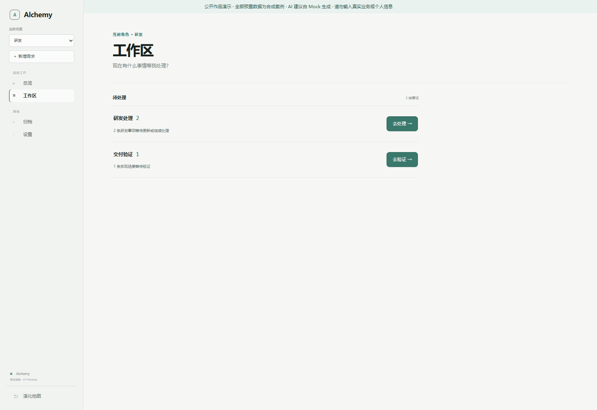
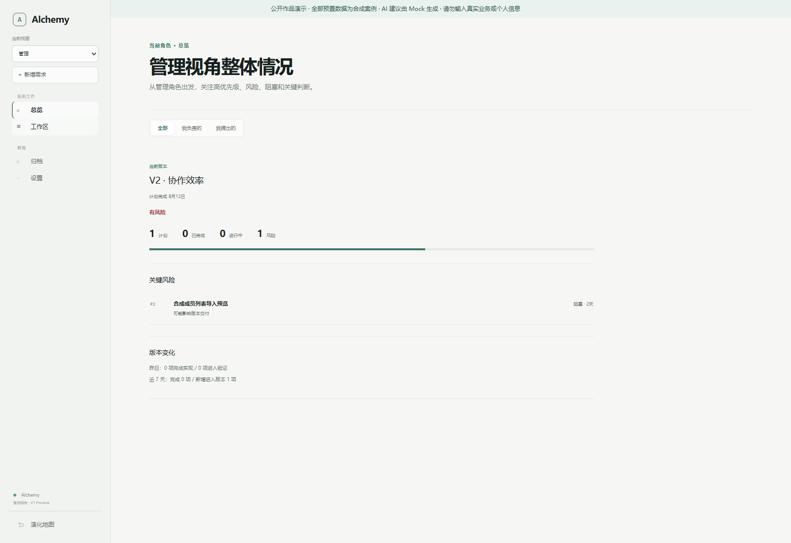

# 产品截图与三分钟讲解

所有图片均由本地公开副本的实际界面截取，使用合成数据和 Mock 分析，没有修改产品代码或伪造界面。2026-11-23，隔离无头 Edge，1600 × 1100 视口；部分图片直接截取工作台、详情正文或图谱元素以便阅读。没有拼接或改写截图内容。

## 三分钟讲解顺序

1. **0:00–0:35**：从生命周期总览说明“对象如何从反馈流向交付验证”，指出数量来自合成场景。
2. **0:35–1:25**：选择两条反馈，查看 Mock 合并建议，人工编辑并确认；说明候选与正式对象的区别。
3. **1:25–2:10**：打开来源图谱与演化记录，说明来源事实、变换、事件和决策各自回答的问题。
4. **2:10–2:40**：切换产品、研发、管理视图，解释角色投影如何改变注意事项与行动队列，而不改变对象事实。
5. **2:40–3:00**：展示架构、32 项已通过测试和原型边界；不宣称真实模型效果、生产能力或业务收益。

## 需求生命周期 / Lifecycle

五阶段总览将阶段分布、风险与最近变化放在同一观察尺度。截图中的数量是预置合成场景的投影。

## Mock 提炼建议 / Draft analysis

选择 SIG-M01 与 SIG-M06，展开原始反馈。建议可以接受或保持独立；截图中的“AI 分析”实际使用确定性 Mock。

## 人工修订 / Human editing

在正式对象生成前改写标题和描述。此处演示如何保留来源，同时由人决定需求表达。

## 最终确认 / Human confirmation

保留两个来源编号，确认后才生成一条 Requirement；草稿不是自动落地的正式决策。

## 来源图谱 / Source lineage

两条 Signal 经已确认的提炼 Transformation 生成一条 Requirement。图谱只显示当前对象的一跳关系。

## 演化与决策 / Evolution and decisions

同一详情页列出来源、操作历史与决策依据。当前记录在内存中，并非持久化、不可篡改的审计日志。

## 产品视图 / Product view

聚焦待判断、停滞和等待协作事项。历史合成日期会使停留天数随查看日期变化，不代表真实业务积压。

## 研发工作区 / Engineering workspace

将当前可处理事项收敛为研发处理和交付验证，不把全部阶段复制为角色导航。

## 管理视图 / Management view

聚焦虚构版本的进度、关键风险和变化；不代表真实交付结果。

[返回 README](../README.md) · [中英文简介](PROJECT_BRIEF.md)
